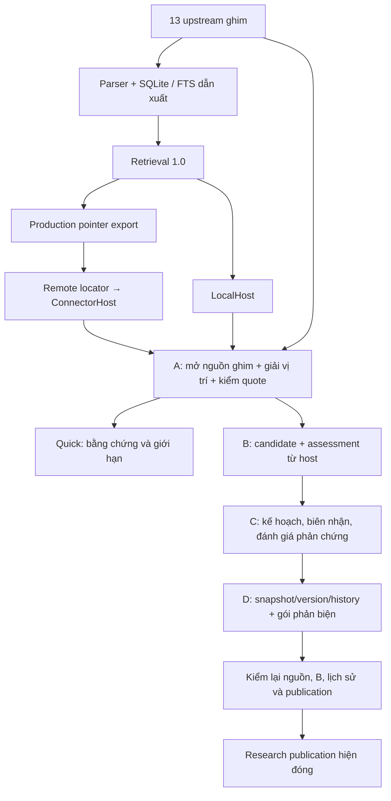

# AI onboarding — BCR 1.0/2.0

> Hướng dẫn tiếp nhận đối chiếu mã tại `57db982274e267218594ae5ca463bd2a42d2be02`
> (11/10/2026). [AGENTS](../AGENTS.md) giữ thẩm quyền luật nghiên cứu;
> [GOVERNANCE](DOCUMENTATION_GOVERNANCE.md) phân miền nguồn chuẩn. Trang này là bản đồ,
> không tạo policy, hợp đồng dữ liệu hay roadmap thứ hai.

## 1. Repo trong 60 giây

Repo chính `quoctran-2608/BuddhismDocuments-for-AI` chứa mã/luật/cấu hình/tests.
13 upstream được ghim trong [manifest](../manifest.json); [corpus config](../config/corpus-sources.json)
ánh xạ tên corpus, repository, evidence class và profile. Không sửa nguồn.
SQLite/FTS local là index dẫn xuất; repo hỗ trợ `BuddhismDocuments-for-AI-remote`
giữ locator pointer-only, runtime do [remote config](../config/remote-corpus.json) quyết định.
Câu chữ có thẩm quyền nằm ở upstream đã mở đúng pin, không ở index hay locator.

1.0 tìm ứng viên, ngữ cảnh, relations/variants với provenance. 2.0 bổ sung A
(nguồn/câu trích), B (luận điểm), C (phản chứng/độc lập nguồn), D (hồ sơ có lịch
sử) và E (host/CLI/tích hợp). Mã A–E đã trên main; nghiệm thu học thuật toàn bộ
2.0 còn thiếu. [PROJECT_SPEC](PROJECT_SPEC.md) giữ mục tiêu và phạm vi.

## 2. Kiến trúc và hai trục sử dụng



E nối các lớp trên; sơ đồ không yêu cầu mọi tác vụ chạy hết. Quick CLI dừng ở
A, không gọi B/C/D hoặc semantic reviewer. Research local tự tạo dự thảo và
thực thi các thao tác C được hỗ trợ; đánh giá nghĩa/độc lập và quyền duyệt cần
host được xác thực. ConnectorHost hiện chỉ nối lookup/kiểm A.

**Môi trường** Local/GitHub Connector/Work quyết định khả năng đọc và chạy mã.
**Quy trình** Quick/Research quyết định các bước cần thiết. D dùng giá trị máy
`environment=local|connector`, `mode=quick|research`; Work không phải enum mới.

| Tổ hợp | Khả năng/bằng chứng thực tế | Giới hạn |
|---|---|---|
| Local × Quick | CLI/LocalHost, fixture và nguồn ghim thật trên WSL; E portable Windows | Ba resolver; không assessment ngữ nghĩa |
| Local × Research | LocalResearch/D, C receipts, revision/reopen/export/import đã chạy với nguồn thật | Draft; approval xác thực chưa có; publication đóng |
| Connector × Quick | ConnectorHost portable; một ca production `ids/mn1` thật đạt A | Callback công cụ do host nối; chưa nghiệm thu toàn Connector |
| Connector × Research | Lõi A–D có contracts/fixture; ConnectorHost có thể gắn `run_id` cho A | Chưa có adapter Research C/D từ xa tích hợp hoặc nghiệm thu toàn luồng |
| Work × Quick | JSON portability và contract phần mềm đã kiểm | Chưa thử phiên Work; chỉ chạy khi runtime có capability hợp lệ |
| Work × Research | Contracts là hướng tương thích | Chưa thử phiên Work, thiếu approval/publication; không tự nhận đã hỗ trợ runtime |

## 3. Bản đồ mã và nơi đọc

Các đường trong bảng tương đối với root repo chính; tên hàm là điểm tìm trong
mã, không phải lời hứa API ổn định. Chọn lớp liên quan trước khi mở cả repository.

| Đường dẫn | Vai trò / khi cần đọc | Entry point | Test/đối chiếu |
|---|---|---|---|
| [manifest](../manifest.json), [corpus config](../config/corpus-sources.json), [remote config](../config/remote-corpus.json) | Pins, mapping, runtime | `source_contract()` trong LocalHost | `cli.source_status`, actual 13 pins test |
| [schema](../schema/corpus-index.sql), [index.py](../tools/corpus_research/index.py), [model.py](../tools/corpus_research/model.py) | Parser/build/migration; mở khi thay index | `build_index`, `Record`, `Work`, `state_parser_version` | [normalization](../tests/test_normalization.py), [text roles](../tests/test_text_roles.py) |
| [retrieval.py](../tools/corpus_research/retrieval.py) | Search/context/resolve, rank và provenance | `search`, `score_record_match`, `resolve`, `evidence` | [acceptance 1.0](../tests/test_acceptance.py), [CJK](../tests/test_cjk_substring_search.py), [CBETA resolver](../tests/test_cbeta_resolver.py) |
| [pointer_export.py](../tools/corpus_research/pointer_export.py), [pointer_production.py](../tools/corpus_research/pointer_production.py) | Pointer identity/export/resume; không xuất raw corpus | `export_pointer_poc`, `export_pointer_production_v1` | [remote access](../tests/test_remote_access.py), [REMOTE_AGENT](REMOTE_AGENT.md) |
| [verification.py](../tools/corpus_research/verification.py) — A | Source binding, quote gate; khi evidence bị chặn | `make_evidence_record`, `evidence_gate`, `verify_quote`, `read_local_source` | [verification](../tests/test_verification.py) |
| [claims.py](../tools/corpus_research/claims.py) — B | Claim subject, assessment, revisions, final gate | `make_claim`, `assess_claim`, `final_claim_gate`, `verify_synthesis` | [claims](../tests/test_claims.py) |
| [counterevidence.py](../tools/corpus_research/counterevidence.py) — C | Per-step scope, hit–A binding, dependency | `make_counterevidence_plan`, `search_counterevidence`, `source_independence`, `assess_counterevidence` | [counterevidence](../tests/test_counterevidence.py) |
| [research_run.py](../tools/corpus_research/research_run.py), [research_store.py](../tools/corpus_research/research_store.py) — D | JSON snapshot + SQLite riêng; audit/version/review | `capture_research_run`, `ResearchStore`, `trace_claim`, `export_review`, `import_review`, `record_review_decision` | [research run](../tests/test_research_run.py) |
| [local_host.py](../tools/corpus_research/local_host.py) — E | Nối index với Git ghim; kiểm profile/capability | `LocalHost.quick`, `verify_record`, `evidence_reader`, `register_plan`, `search_reader` | [local integration](../tests/test_local_integration.py) |
| [local_research.py](../tools/corpus_research/local_research.py) — E | Orchestration dự thảo, mở lại run | `LocalResearch.create`, `prepare`, `capture`, `finalize`, `publication_check` | local integration + [corpus thật](../tests/test_corpus_integration.py) |
| [connector_host.py](../tools/corpus_research/connector_host.py) — E | Adapter không SQLite/shell/mạng tự động | `ConnectorHost.lookup`, `verify_pointer` | [connector contract](../tests/test_connector_contract.py) |
| [source_resolvers.py](../tools/corpus_research/source_resolvers.py) — E | Ba định dạng; giải span/vai trò từ nguồn ghim | `resolve_source` | [span selection](../tests/test_source_span_selection.py), corpus thật |
| [bin/buddhist-corpus](../bin/buddhist-corpus), [cli.py](../tools/corpus_research/cli.py) | CLI 1.0 | `parser`, `main` | [CLI](CLI.md), acceptance/remote access |
| [bin/buddhist-research](../bin/buddhist-research), [v2_cli.py](../tools/corpus_research/v2_cli.py) | CLI E riêng | `parser`, `main` | [USAGE](v2/USAGE.md), local integration CLI tests |
| [tests](../tests), [golden cases](../tests/fixtures/v2/golden-cases.json), [evidence](v2/evidence/README.md) | Expected phần mềm, kết quả thực thi và benchmark | unittest; [v2_benchmark.py](../tools/corpus_research/v2_benchmark.py) | [ACCEPTANCE](v2/ACCEPTANCE.md), [E_REPORT](v2/E_REPORT.md) |

Corpus SQLite giữ records/works/relations/variants/lemmas và chỉ mục FTS;
ResearchStore dùng DB riêng, snapshot append-only, `expected_version` chống ghi
đè. Không sửa schema corpus để lưu run. D bảo vệ đường API/transaction; host
vẫn chịu trách nhiệm quyền file DB và xác thực reader.

## 4. Giao diện thật

| Giao diện | Input → output | Ví dụ tối thiểu / nguồn chi tiết | Giới hạn |
|---|---|---|---|
| CLI 1.0 | Truy vấn/ID + index → JSON retrieval | `bin/buddhist-corpus search 'sutaṃ' --language pli`; [CLI](CLI.md) | Local; `evidence` gom dữ liệu, không qua A |
| CLI E | Query/record ID hoặc run/version/report → JSON gate/run | `bin/buddhist-research quick 'sutaṃ' --corpus suttacentral-bilara --limit 1`; [USAGE](v2/USAGE.md) | Global options trước subcommand; default không semantic approval |
| Python host | Root/index + executable readers → gate envelopes/run snapshots | Ví dụ dưới; [USAGE/API](v2/USAGE.md#python-api-và-hợp-đồng-host) | API đang phát triển; host chọn quyền và cấu hình, không JSON của AI |
| GitHub Connector | Config + key `terms/latin` hoặc `ids` → bucket row → pinned source → A | `host.lookup('ids', 'mn1')`; [REMOTE_AGENT](REMOTE_AGENT.md) | Không Code Search router, không production `terms/cjk`; callback thiếu binding giữ UNVERIFIED |
| JSON contracts | Evidence/claim/plan/run/package/report → validation và status riêng | [DESIGN](v2/DESIGN.md) + code validators/tests | Dữ liệu chuyển được qua JSON không chuyển được quyền của callback |

Ví dụ Python local, từ root repo với `PYTHONPATH=tools`, index đã có đúng pins:

```python
from pathlib import Path
from corpus_research.local_host import LocalHost
from corpus_research.local_research import LocalResearch

host = LocalHost(Path('.'), Path('derived/corpus.sqlite3'))
result = host.quick('sutaṃ', corpus='suttacentral-bilara', limit=1)
# Chỉ result['verified_evidence'] đã qua A; đọc verification/limitations.
research = LocalResearch(host, Path('derived/research.sqlite3'))
draft = research.create(run_id='example-1', question='Đoạn ghim ghi câu nào?',
    queries=['sutaṃ'], corpora=['suttacentral-bilara'], limit=1,
    counter_queries=['anicca'])
```

`run_id` phải mới; ví dụ create ghi DB dự thảo. Quick không tạo DB run.
Không có giao diện web hoặc REST API trong repository này. Callback source
phải đọc đủ nội dung ở ref ghim, bảo toàn identity/blob và giải vị trí; việc
truyền một dict `opened_source` hoặc cờ `approved` không thay reader tin cậy.

## 5. Quick và Research thực thi thế nào?

**Quick:** retrieval chọn hit → pointer → đọc Git nguồn ghim → resolver giải
unit/span → A kiểm pin/blob/vị trí/vai trò/quote và đọc nguồn độc lập lần hai.
Trả retrieval giữ nguyên rank cùng `verification`, `verified_evidence` và giới
hạn; `publication_authorized=False`, `claim_assessment=NOT_REQUESTED`.
Quick không tự xác nhận nghĩa triết học hoặc độ đúng của một claim.

Resolver chỉ chọn span liên tục từ nguồn gốc: Quick theo query, `quote --text`
theo câu trích exact/normalized; không hint thì dài nhất. Không nối qua markup,
JSON escape hoặc dùng offset tự khai. Hit lemma/FTS/metadata hay query xuyên
span có thể tìm được nhưng chưa tạo quote VERIFIED. Đọc source/context rồi
kiểm câu thực ở đúng unit, theo [giới hạn resolver](v2/USAGE.md#quick-và-câu-trích).

**Research local:** câu hỏi/phạm vi/query → retrieval/A → literal textual
candidate (dự thảo hẹp, không diễn giải tự động) → kế hoạch C → chạy thao tác
được hỗ trợ, lưu receipts → D capture A/B/C, version/lịch sử → export package
JSON/Markdown → import report `PROPOSED` → host decision nếu có reader hợp lệ
→ kiểm publication. C bound/profile/unchecked scope được giữ trong hồ sơ;
parallels/variants chưa có A resolver phù hợp, báo incomplete.

CLI mặc định không có semantic approval; B/C assessment nghĩa còn UNVERIFIED,
finalize bị chặn khi checks chưa đủ. Host ứng dụng phải xác thực người duyệt,
gắn assessment với **đúng claim subject, bằng chứng hiện hành, scope, basis và
limitations**, kiểm dependency/C và lịch sử đầy đủ. AI không tự nối oracle test
hoặc chọn reader/reviewer để qua cửa. Ngay cả cấu hình callback đầy đủ, B giữ
guard Research và D `check_publication` luôn trả chưa được phép; E chưa mở kênh
công bố. [D review contract](v2/USAGE.md#review-package-và-trạng-thái) chỉ lưu
quyết định kiểm được, không cấp giấy phép xuất bản.

## 6. Các ranh giới tin cậy

| Dữ liệu/trạng thái | Ý nghĩa và ranh giới |
|---|---|
| Search hit, rank, pointer | Gợi ý mở nguồn; pointer không phải nội dung nguồn |
| Metadata/alignment/bridge | Chứng minh loại quan hệ phù hợp nếu được kiểm, không chứng minh câu chữ hay textual identity |
| A `VERIFIED` | Nguồn/quote đạt cửa A; không tự cấp semantic assessment hay claim acceptance |
| B `ASSESSED` | Đánh giá hợp lệ; xem mức `DIRECT/STRONG/WEAK/UNSUPPORTED/CONTRADICTED`; `REJECTED` có thể vẫn chứa assessment object nhưng không hợp lệ |
| C `SEARCHED` | Hoàn tất phép tìm trong scope/steps đã khai; không tự chứng minh hit phản bác claim hoặc không có phản chứng ngoài mẫu |
| Claim `candidate/accepted/rejected/superseded` | Vòng đời do gate/lịch sử quyết định, khác mức hỗ trợ; Research hiện không được nâng thành accepted để công bố |
| Report `PROPOSED`, decision `RECORDED` | Hai đối tượng riêng; JSON approved hoặc đồng ý của AI khác không có thẩm quyền; RECORDED vẫn không cấp publication |
| Run `finalized` | Chốt hồ sơ kiểm toán có checks đạt; vẫn có thể giữ claim UNSUPPORTED/CONTRADICTED hợp lệ ở tập bị bác bỏ; không phải kết luận đã được phép công bố |
| Snapshot/hash/history | Dấu vết để kiểm toán; không thay fresh A/B/C/host-context checks và complete current history ở lần dùng tiếp |

Nhiều repo/citation không đương nhiên độc lập: khi thiếu dependency evidence,
giữ `uncertain` và không bịa số nguồn độc lập. Nguồn gốc phải giữ repository,
path tương đối, pin/blob khi có, work/segment, language, evidence_class,
text_role, witness. Note không được dùng như root; claim lịch sử/thực nghiệm/
siêu hình không được coi đúng chỉ vì một đoạn kinh nói như vậy.

## 7. Mức hoàn thành cần đọc riêng

Mốc phần mềm dưới đây lấy từ [evidence cuối](v2/evidence/README.md), không là
nghiệm thu học thuật. [Ma trận 33 yêu cầu](v2/ACCEPTANCE.md) vẫn giữ tiêu chí.

| Năng lực | Có mã | Software tests | Nguồn ghim thật | Runtime đích | Nghiệm thu học thuật |
|---|---|---|---|---|---|
| Retrieval 1.0 | Có | 45 tests; E1 mẫu giữ output/rank | Acceptance profile | Local WSL; locator đã production | Không là chứng nhận đúng mọi kết luận |
| A–D lõi | Có | A44/B82/C70/D77 | E nối A, C receipts, D draft/export | Local WSL; callback approvals là fixture | Chưa đủ semantic/independent review |
| Quick E | Có, 3 resolver | E portable 78 + E corpus 14 (chia sẻ với Research) | Bilara/CBETA/84000 | Local WSL; Windows portable | Không suy rộng đủ 13 nguồn |
| Research E | Có draft/review | Version/reopen/export/import/guards | Draft và C lexical thật | Local WSL | Publication đóng; chưa ground truth/reviewer thực |
| Connector E | Có adapter | Contract + span regressions | Một ca Bilara production | Một ca GitHub công cụ thật | Toàn Connector chưa nghiệm thu |
| Work | Contracts chuyển JSON | Fixture portable | Chưa có phiên Work | Chưa kiểm | Chưa nghiệm thu |
| Hiệu quả E1–E3 | Có benchmark runner | E1/E2 mẫu, E3 draft cost | Cùng pins/index acceptance | Phép đo WSL ở checkpoint trước sửa span | Chờ ngưỡng; chất lượng/token/AI cost chưa đo |

WSL cuối E 410/410; Windows E portable 78/78; Windows full chưa đạt. Logs
được commit ghi chạy mã `4986216…`; commit evidence-only `57db982…` giữ nguyên
mã đó, có lần chạy lại full WSL được báo riêng. Đọc [evidence provenance](v2/evidence/README.md)
trước khi gán số đo cho một commit. Benchmark và checkpoint 394 tests cũ không
được đổi thành phép đo sau sửa span.

## 8. Đường đọc ngắn theo vai trò

- **AI researcher:** [AGENTS](../AGENTS.md) → [SKILL](../.codex/skills/buddhist-corpus-research/SKILL.md)
  → [corpus config](../config/corpus-sources.json)/[manifest](../manifest.json), hoặc [remote config](../config/remote-corpus.json)
  → [USAGE](v2/USAGE.md) (Quick local) / [REMOTE_AGENT](REMOTE_AGENT.md) (Connector) → nguồn ghim.
  Lookup hẹp chỉ cần nhánh này; câu hỏi sâu dùng Research draft và giữ phần chưa duyệt.
- **AI developer:** [README](../README.md) → trang này → [ARCHITECTURE](ARCHITECTURE.md)
  → dòng module liên quan ở mục 3 → tests cùng lớp. [CLI](CLI.md)/[USAGE](v2/USAGE.md)
  cho entry points; không sửa source/pins, retrieval 1.0 hay approval chỉ để làm ví dụ chạy.
- **AI reviewer:** [DESIGN](v2/DESIGN.md) → [REQUIREMENTS](v2/REQUIREMENTS.md)
  → [ACCEPTANCE](v2/ACCEPTANCE.md) → [E_REPORT/evidence](v2/E_REPORT.md)
  → [review contract](v2/USAGE.md#review-package-và-trạng-thái), code/tests D và B.
  Kiểm snapshot, history, current source/assessment và C scope; phát hiện self-approval
  bằng nguồn của reader, không bằng cờ JSON. Chỉ cần ADR liên quan khi hỏi lý do kiến trúc.

## 9. Troubleshooting

| Tình huống | Nhận diện / hành động đúng | Đọc tiếp |
|---|---|---|
| Thiếu checkout/Git object hoặc SHA sai | `status` source contract lỗi; dừng nhánh, không tải dữ liệu nghiên cứu | AGENTS mục 2–3; manifest |
| Thiếu/stale index, profile hỗn hợp, WAL | CLI/host báo lỗi; chỉ build/checkpoint riêng bằng nguồn đã có; không bỏ check | [CLI profiles](CLI.md#2-build-profile), [USAGE](v2/USAGE.md#chuẩn-bị-local) |
| Pointer thiếu vị trí hoặc định dạng chưa hỗ trợ | A không VERIFIED; không đoán segment/offset, đọc locator thật hoặc nêu thiếu dữ liệu | source_resolvers, USAGE |
| `QUOTE_MISMATCH`, sai unit | Kiểm đúng pin/unit/câu nguyên nguồn, không nối span hay làm mềm quote sai | A/USAGE Quick |
| Search no-hit | Chỉ chưa tìm trong profile/query; thử dạng có căn cứ trong corpus, không suy thành không tồn tại | SKILL/CLI |
| C không thấy phản chứng hoặc incomplete | Đọc từng step corpus/pin, bound, checked/unchecked scope; cần đánh giá nghĩa từ host | C/ACCEPTANCE |
| Approval chưa cấu hình | assessment/finalize chưa đạt; xuất draft để phản biện, không nhập JSON tự duyệt | [USAGE Research](v2/USAGE.md#research-dự-thảo-và-thẩm-định) |
| Research publication bị chặn | Kết quả hiện đúng `publication_authorized=False`; finalized/RECORDED không mở cửa | B guard, D check_publication |
| Run/version/package stale | Đọc version mới, kiểm snapshot hiện hành; sửa tạo bản mới, duyệt lại, không ghi đè lịch sử | D/USAGE review |
| Connector thiếu locator/source binding | Đọc config, pin locator, mở đúng ref/path/full content; thiếu capability giữ UNVERIFIED | REMOTE_AGENT/ConnectorHost |
| Work không có capability/bằng chứng phiên thật | Chỉ nói contract portable; ghi chưa kiểm/chưa xác minh runtime | E_REPORT/ACCEPTANCE |

## 10. Giới hạn hành động của AI

Theo [AGENTS](../AGENTS.md): không thêm internet/trí nhớ mô hình thành nguồn
thứ 14, sửa nguồn ghim, hòa nhân chứng, bịa tương đương đa ngôn ngữ/provenance
hoặc thay missing data bằng giả định. Không tự chọn reviewer/capability, tái
sử dụng snapshot như approval, hoặc tuyên bố Research được phép công bố.
Khi không đủ dữ liệu, dùng thông báo fail-closed đúng môi trường trong AGENTS/SKILL.
