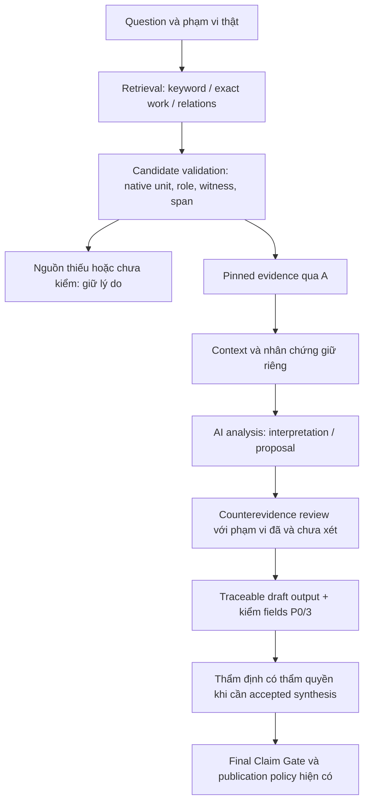

# Quy trình đích: đưa chứng cứ có thể kiểm tới AI nghiên cứu

Ngày 06/11/2026. **ĐỀ XUẤT CHỜ THẨM ĐỊNH**, không phải command/API mới đã có.
Hiện trạng và mã bằng chứng E1–E8 xem [capability audit](BCR_CAPABILITY_AUDIT.md).
API thực vẫn theo [USAGE](../../v2/USAGE.md),
[P0/1](../../v2/P0_1_USAGE.md), [P0/2](../../v2/P0_2_USAGE.md),
[P0/3](../../v2/P0_3_USAGE.md).

## 1. Luồng nghiên cứu

Không phải mọi lookup phải chạy toàn bộ sơ đồ. Quick vẫn dừng sau source/A/
context cho tra cứu hẹp; Research draft giữ claims, phản biện và trace. Nghiên
cứu khám phá chưa đủ điều kiện accepted có thể dừng ở **dự thảo**, với thiếu
hụt công khai. Mũi tên tới G không khẳng định có đường publication đã được mở.

| Bước | BCR đã đảm nhiệm được | Agent phải làm | Phần còn cần cải thiện |
|---|---|---|---|
| Question/scope | Host context, source contract, D question/queries/scope | Chọn câu hỏi, claim nguyên văn khi có, mục đích khám phá hay kiểm nguồn khai báo | Preflight dễ đọc; coverage nhiều profile chính xác |
| Retrieval | 1.0 search/work/resolve/parallels/variants/compare; Connector locator | Đề xuất thuật ngữ có căn cứ, mở rộng có giới hạn | Trình bày candidates và truncation thống nhất, không giả exhaustive |
| Candidate validation | `source_reader`, resolver, `verify-source`, A | Đối chiếu native keys, lựa chọn có nhãn, làm rõ ambiguity | Native catalog rỗng/escape/role/witness tổng hợp chưa có |
| Pinned evidence | A envelope, pin/blob/location/quote và evidence ID | Chỉ viện dẫn phần đã mở/kiểm | Nhiều định dạng corpus chưa có resolver; không bù bằng index |
| Context | Index neighbors, nguồn/context ranges A | Đọc đủ đoạn để xác định speaker, điều kiện, ngoại lệ | Cần view có nhãn index context và source context; không nối quote qua markup |
| AI analysis | B claim contract; P0/2 optional support/challenge | Lập luận, giữ điều kiện/khác biệt, nêu unresolved | Chưa có bảo đảm ngữ nghĩa; không tự tạo model adapter |
| Counterevidence | C plan/receipts, bounded executor, dependency uncertainty | Xét nghĩa từng nguồn phản bác; sửa/hạ claim có trace | Quan hệ/variants chưa A-integrated đầy đủ; chưa có planner semantic được nghiệm thu |
| Output | D trace/export, P0/3 fields/links, JSON receipts | Viết prose có giới hạn, tự soát lượng từ/causal inference | Một pack/view liền mạch và citation rendering dễ đọc |

## 2. Rẽ nhánh trước khi khai báo nguồn

**Khi claim đã nêu nguồn bắt buộc:** giữ nguyên text/ID và reference gốc. Mở
chính work/path/pin/witness ấy. Preview bổ sung thông tin cho caller, không
âm thầm thay hoặc bỏ reference sai. `verify_declared_source` đã dùng được
trước `create_declared_run`. Missing/pin mismatch/witness sai/mơ hồ phải giữ
reason thật; không chuyển sang lexical hit để hợp thức hóa claim.

**Khi đang khám phá nguồn:** query/parallel/variant hit là ứng viên. Xem source
và native keys trước khi chọn một reference mới. Việc một khóa rỗng không làm
toàn bộ tác phẩm mất, nhưng cũng không cho phép chép câu của unit hoặc witness
khác vào khóa ấy. Candidate ngoài reference ban đầu giữ `EXPANDED`; khi caller
muốn sửa reference, tạo đầu vào/run mới hoặc revision đúng cơ chế lịch sử,
nêu lý do và giữ bản trước. Không sửa hồ sơ Pilot đã khóa.

Ví dụ MN 135: các keys EN 5.5/6.5/7.4/7.5 có giá trị rỗng ở pin đang xét.
Một preview nên chỉ ra điều này và các keys **thực có** cùng witness; không
gọi 5.2/5.3 là bản thay thế tương đương về nghĩa. Nếu reference bắt buộc chính
là key rỗng, nó vẫn UNVERIFIED. Nếu danh sách mới chỉ là candidates chưa chốt,
agent đọc nguồn rồi chọn locator phù hợp với câu hỏi trước khi bind. Chính
sách all-or-nothing P0/1 không đổi.

Preview đề xuất là lớp **đọc/chẩn đoán**, không thêm state “đã duyệt”. Cần phân
biệt được: key không tồn tại, key rỗng, text có escape/markup nhưng resolver
chưa hỗ trợ, file/pin sai, sai work/witness, mơ hồ và ngoài index. Hiện reason
`SOURCE_OR_SEGMENT_UNAVAILABLE` gộp nhiều trường hợp; cần giữ raw reason hiện
hữu và thêm giải thích bằng dữ kiện nguồn, không phát minh bản văn.

## 3. Ngữ cảnh và đa nhân chứng

- Giữ `context_before/context_after` từ index khác với context đã A đọc từ
  pinned blob. Index có thể flatten/chunk; quote verified là span liên tục
  thật, chưa chắc phủ đủ một câu hoặc cuộc đối thoại.
- Root, bản dịch, translator comment/note, apparatus, computational segment
  và metadata có labels riêng. Không đọc heading/container title như title
  tiểu kinh hoặc lấy note làm lời kinh.
- SN 35.145/146: UID, acronym, alternative acronym và edition/witness giữ
  namespace riêng. Mapping metadata có provenance không là textual identity.
- Pāli: exact → normalization/fold → lemma/variant từ corpus → context.
  Không có lemma trong index hiện tại thì nêu thiếu coverage; không dùng trí
  nhớ làm từ điển ngầm. Hán văn: local trigram theo giới hạn; Connector không
  tự có arbitrary CJK search.
- SC relation → bridge → CBETA textual witness là ba bước. Giữ quan hệ chưa
  mở/kiểm riêng khỏi chứng cứ câu chữ. Hai bản dịch không tự là hai nhân chứng
  độc lập; dependency chưa biết vẫn `uncertain`.

## 4. Research Evidence Pack: khả thi, chưa là sản phẩm hoàn chỉnh

**Kết luận khả thi:** dữ liệu nền đã có đủ cho một pack local tối thiểu ở ba
resolver hỗ trợ. Không cần DB mới hoặc thay schema Claim/Evidence. Còn thiếu
orchestration một lần gọi, native preview, coverage summary và cách render
đồng bộ candidates thất bại/context/relations. Pack không thể hứa đầy đủ cả
13 corpus hoặc Connector Research chỉ vì JSON chuyển được giữa môi trường.

Pack trước hết là **bản nhìn/xuất của dữ liệu hiện hữu**, không một source of
truth mới. Các nhãn tổ chức bên dưới là thiết kế trình bày, chưa phải tên
fields/API công bố hoặc schema mới:

| Nội dung mong muốn | Tái sử dụng dữ liệu/đường có thật | Phần thiếu hoặc giới hạn |
|---|---|---|
| Question, mục đích, queries, scope | D run question/queries/search_hypotheses/scope/limitations; host context | Phân biệt scope khai báo và scope đã thực thi |
| Candidate list và origin | Retrieval results, P0/1 declared_bindings, EXPANDED discovery, C receipts | Query-create, declared-sidecar và expansion hiện rời nhau; không chỉ lấy top hit |
| Evidence ID, A status/reason/checks thật | Fresh `verify_pointer`/`evidence_reader`; failed bindings giữ riêng | D snapshot đơn lẻ không luôn có đầy đủ failed candidates; phải giữ sidecar |
| Text, quote, context | A quotation/context + labeled index neighbors khi cần | Không coi index snippet/AI summary là text evidence; source span có giới hạn |
| Source SHA/blob/path/work/segment | Evidence record/source identity hiện hành | Không thêm edition giả; P0/1 input không có source_sha256/edition phổ quát |
| Witness, role, class, language | Resolver/A; title/identifier fact provenance khi có | Không áp title SN cho mọi collection; dữ kiện chưa có ghi unavailable |
| Bản dịch khi có | Evidence của từng translation witness/path/pin riêng | Không ghép cùng số unit thành word alignment hoặc tự động độc lập nguồn |
| Parallels/metadata/variants | Retrieval raw relations/variants, pinned metadata facts khi hỗ trợ | Giữ metadata-only/chưa A; underlying editions chưa mở phải nói rõ |
| Chưa xác minh và lý do | P0/1 failures/gate checks, C step limitations, missing_evidence_ids | Không đổi lỗi thiếu capability thành false claim verdict |
| Phạm vi chưa phủ | source_state/parser state, query/corpus/language/limit, C unchecked scope | Exact recall, mọi ngôn ngữ/edition và kết quả ngoài top-N chưa biết |
| Claim/analysis/counter review | B candidates, C receipts, D trace/revisions, P0/2 proposal tùy chọn | Semantic notes/summary của AI không là nguồn hoặc approval |
| Dấu mốc và kiểm lại | main commit, run/version/snapshot hashes, output checks | Hash chỉ trace; mở lại bằng reader khi tái sử dụng, không replay status |

### Tái sử dụng trước khi tạo gì mới

`retrieval.evidence` đã gom record + context + provenance + variants nhưng
chưa A. `LocalHost.quick` thêm A cho hits, không có toàn bộ Research Pack.
`ResearchStore.export_review` đã có snapshot đầy đủ/history, không cần run
được accepted/finalized; cần capture trước export và `expected_version` hiện
hành. `trace_claim` nối claim với evidence/counter và successor nhưng là
historical observation. P0/3 kiểm các items/links khi host được giữ đúng.

Vì vậy thử nghiệm triển khai tối thiểu sau phê duyệt nên **compose các kết quả
này**, giữ sidecar của nguồn failed/expanded, thêm summary/render. Chưa có
command `evidence-pack` trong baseline; không hướng dẫn người dùng chạy một
lệnh chưa tồn tại. Chỉ tạo schema/envelope public mới nếu composer không
trình bày được các trường cần thiết và có ví dụ đầu vào/đầu ra chứng minh.

### Hai hình thức hiển thị, cùng dữ liệu

1. Bản nhìn nghiên cứu: câu hỏi/phạm vi; bảng nguồn và trạng thái; context có
   nhãn witness; claim/proposal kèm citations; phản biện đã/chưa xét; thiếu hụt.
2. Phụ lục máy đọc: JSON nguyên envelope/run/sidecar, queries, source identity,
   version/hash và trace links. Summary không thay phụ lục hoặc nguồn.

Title/ID/citation nên lấy từ facts/identity hiện hành rồi render, giảm thao
tác gõ lại. Khi reader chưa hỗ trợ title MN/AN hoặc CBETA subwork, giữ nhãn
chưa kiểm và source locator; không dùng index.title hoặc AI tự điền như facts.
Free prose là interpretation và vẫn có thể sai dù mọi citation đúng.

### Tái sử dụng và phân phối

Pack lưu local ngoài upstream/index; append/fresh output stem, không ghi đè
lịch sử. Khi dùng lại, nhận locator/quote làm **đề nghị đọc lại**, mở đúng pin
qua capability thật và kiểm version/currentness. Stored `VERIFIED/CHECKED`
không phải vé sử dụng hoặc quyền xuất.

Pack chứa source excerpts không tự được chia sẻ. Giữ quyền từng nguồn và
chính sách dữ liệu hiện hành; `DISTRIBUTION_CLEARED=0`. Export local không là
giao chuyên gia hay publication. Bản công khai của hạ tầng chỉ gồm metadata
được phép; không sao chép raw source/private article/Pilot bundle. Quyền
chia sẻ phải được xác lập riêng, không suy từ giấy phép một website chung.

## 5. Ranh giới kiểm chứng và trạng thái

| Nhãn/lớp | Xác nhận trong phạm vi nào | Không xác nhận |
|---|---|---|
| Retrieval hit / CANDIDATE | Có ứng viên trong route/query/index được nêu | Đã đọc, đúng tác phẩm claim viện dẫn, hỗ trợ nghĩa |
| A `VERIFIED` | Nguồn/identity/location và quote checks áp dụng đạt qua reader | Claim đúng, ngữ cảnh đủ, dependency độc lập, quyền sử dụng |
| P0/3 `CHECKED` | Các fields/links/annotations đã ghi nhất quán theo contract | Ngữ nghĩa CONCLUSION.text hoặc notes đầy đủ/đúng |
| P0/2 proposal / AI_INTERPRETATION | AI đã đề xuất theo trace thực nếu có, citations/schema đã kiểm | B assessment được phê duyệt hoặc model có semantic authority |
| B `accepted` (thường gọi ACCEPTED) | Kết quả Final Claim Gate với authority/checks đúng mode | Nguồn tự là đúng giáo lý hoặc tự có quyền công bố ngoài host |
| D finalized / hash / RECORDED | Snapshot/history/decision được ghi theo contract | Semantic truth hoặc publication permit |
| Publication | Quyết định riêng theo host/rights/currentness và gates | Không suy từ bất kỳ nhãn phía trên; Research hiện không được phép |

Pin/quote exact/normalization có thể kiểm tất định. Đánh giá paraphrase,
speaker, causal/temporal scope, dịch nghĩa hoặc giá trị phản bác vẫn cần diễn
giải và thẩm định phù hợp. Links hợp lệ không chứng minh quan hệ suy luận đúng.

## 6. Thao tác khả dụng ngay và phần chỉ đề xuất

**Có thể làm ngay bằng API cũ:** preflight tường minh → retrieval/work → mở
source/verify-source trước khi tạo draft → P0/1 cho refs đã khai báo → đọc
context và ghi notes → C với queries có phạm vi → trace/export draft → P0/3
cho fields được hỗ trợ. Khi mixed scope bị chặn, giữ subrun riêng và khai
giới hạn; không override guard. Đây còn là workflow nhiều thao tác.

**Chưa triển khai trong nhánh này:** native candidate catalog, preflight
tổng hợp, sửa profile policy, pack composer, title coverage mở rộng và renderer
liền mạch. Không có mode/schema/API mới, không nới gate. Xem
[roadmap](BCR_PRIORITIZED_ROADMAP.md) để quyết định từng PR sau thẩm định.

`HUMAN_ADJUDICATION_PENDING` · `DISTRIBUTION_CLEARED = 0` · `PUBLICATION_NOT_PERMITTED`.
